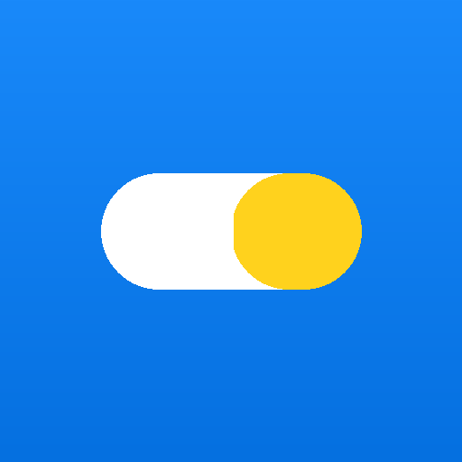

# 智药通 — AI 老年人用药安全助手

<div align="center">



**📷 拍照识药 · ⚠️ 相互作用检查 · ⏰ 语音提醒 · 🎙️ 语音问答 · 📱 PWA 离线可用**

[](https://vuejs.org)
[](https://fastapi.tiangolo.com)
[](https://vite-pwa-org.netlify.app)
[](LICENSE)

</div>

> **传智杯 AI 创新应用挑战赛参赛作品（个人赛）**
> 一款专为老年人设计的 AI 用药安全 H5/PWA 应用
> 核心解决"看不懂药盒说明"、"记不住服药时间"、"不知药物能不能一起吃"三大痛点

---

## 🎬 在线演示

> 👉 地址在提交后填入：[待部署到 Vercel 后回填](DEPLOY.md)

---

## 📑 目录

- [✨ 核心功能](#-核心功能)
- [🖼️ 功能演示](#-功能演示)
- [🏛️ 技术架构](#-技术架构)
- [🛠️ 技术栈](#-技术栈)
- [🚀 快速开始](#-快速开始)
- [⚙️ 环境变量](#-环境变量)
- [📁 项目结构](#-项目结构)
- [📝 AI Prompt 快照](#-ai-prompt-快照)
- [🏆 比赛评分点对应](#-比赛评分点对应)
- [🧪 演示视频脚本](#-演示视频脚本)
- [🤝 部署到生产](#-部署到生产)
- [🩺 免责声明](#-免责声明)
- [📄 License](#-license)
- [🙏 致谢](#-致谢)

---

## ✨ 核心功能

| # | 功能 | 描述 | AI 模型 |
|---|---|---|---|
| 📷 | **拍照识药** | 上传/拍摄药盒照片 → 2-5 秒返回药品名、规格、用法用量 | 阿里云百炼 **通义千问 VL** |
| ⚠️ | **相互作用检查** | 选 2+ 药品 → RAG 检索说明书 → 4 级风险提示 + 建议 | DeepSeek + ChromaDB |
| ⏰ | **服药提醒** | 设置每日提醒时间，到点震动 + Edge-TTS 语音播报 | Edge-TTS（Microsoft 免费） |
| 🎙️ | **语音问答** | 按住说话 → ASR 转文字 → 大模型问答 → TTS 播报 | DeepSeek + Edge-TTS |
| 📱 | **PWA 离线** | 可添加到主屏；断网仍能看清单、检查已加载的药品 | Workbox Service Worker |
| 💊 | **用药清单** | localStorage 持久化的今日/全部药品管理 | - |
| 🔍 | **相互作用弹窗** | 首页一键检查清单中所有药品的相互作用 | DeepSeek |

## 🖼️ 功能演示

> 演示截图存放在 [docs/screenshots/](docs/screenshots/) 目录，下方是分镜示例。

### 首页 — 今日清单 + 提醒 + 一键检查

> 📸 [home.png](docs/screenshots/home.png) · 移动端 540×960 截图
>
> 说明：首页分三个色块——顶部「今日服药提醒」（含未服药红色徽标）、中部「我的用药清单」（以卡片形式列出药品，含「VL 识别」/「手动添加」两种来源标识）、底部「检查相互作用」按钮（药品 ≥ 2 时高亮可点）。

### 拍照识药 — 拍照 / 上传 / 识别 / 入库

> 📸 [scan-upload.png](docs/screenshots/scan-upload.png) · 拍照或相册选择
> 📸 [scan-result.png](docs/screenshots/scan-result.png) · VL 返回的药品详情卡
>
> 流程：选图 → 2-5s 展示「📦 氨氯地平片 5mg 用法: 每日 1 次 1 片 饭后」→ 可选「加入我的清单」或「再拍一张」。

### 相互作用检查 — 风险分级展示

> 📸 [interaction.png](docs/screenshots/interaction.png) · 风险卡片
>
> 4 级色标：🔴 严禁（critical）· 🟠 较严重（major）· 🟡 中等（moderate）· 🟢 轻微（minor）。
> 老年用户视觉特征 → 高对比配色 + 大字号 + 友好语句。

### 语音问答 — 按住说话 + 自动播报

> 📸 [voice-qa.png](docs/screenshots/voice-qa.png) · 对话界面
> 📸 [voice-button.png](docs/screenshots/voice-button.png) · 按住说话按钮
>
> 体验：用户按住底部话筒 → 说话 → 松开 → 后端流式返回 → 文字 + TTS 同步播报。

### PWA 安装 — 桌面/主屏

> 📸 [pwa-install.png](docs/screenshots/pwa-install.png) · Chrome 安装提示
> 📸 [pwa-homescreen.png](docs/screenshots/pwa-homescreen.png) · iOS 主屏图标
>
> 安装后应用独立窗口运行，可离线使用清单功能。

---

## 🏛️ 技术架构

```
┌────────────────────────────────────────────────────────┐
│                  用户手机（PWA）                       │
│   Vue3  │ Vue Router │ Pinia │ Vant │ vite-plugin-pwa   │
└──────────────────────┬─────────────────────────────────┘
                       │ HTTPS / Service Worker
                       ▼
┌────────────────────────────────────────────────────────┐
│        FastAPI 后端（gunicorn + uvicorn worker）       │
│   /api/medicine/recognize   (通义千问 VL)              │
│   /api/interaction/check    (DeepSeek + RAG)           │
│   /api/voice/chat           (DeepSeek)                 │
│   /api/voice/tts            (Edge-TTS, 无需 Key)       │
└──────────┬────────────────────────┬────────────────────┘
           │                        │
           ▼                        ▼
   ┌──────────────┐         ┌────────────────┐
   │ 阿里云百炼    │         │  DeepSeek API   │
   │ DashScope     │         │  深度求索       │
   │ (VL 识图)     │         │  (对话 + RAG)   │
   └──────────────┘         └────────────────┘
                                       │
                                       ▼
                              ┌────────────────┐
                              │  ChromaDB      │
                              │  向量库        │
                              │ (BAAI/bge-small-zh) │
                              └────────────────┘
```

---

## 🛠️ 技术栈

### 前端（`frontend/`）

| 技术 | 版本 | 用途 |
|---|---|---|
| Vue | 3.5 | 渐进式前端框架（Composition API）|
| Vite | 5.4 | 构建工具 + Dev Server |
| Vue Router | 4.4 | SPA 路由（懒加载）|
| Pinia | 2.2 | 状态管理（含 localStorage 持久化）|
| Vant | 4.9 | 移动端 UI 组件库（按需引入 26 个）|
| Axios | 1.7 | HTTP 客户端 + 拦截器 |
| Day.js | 1.11 | 时间格式化（轻量替代 moment）|
| **vite-plugin-pwa** | 0.21 | PWA / Workbox / Service Worker |
| workbox-window | 7.3 | SW 注册 + 更新检测 |

### 后端（`backend/`）

| 技术 | 版本 | 用途 |
|---|---|---|
| FastAPI | 0.115 | 异步 Web 框架 |
| Pydantic | 2.9 | 数据验证 + OpenAPI |
| httpx | 0.27 | 异步 HTTP 客户端 |
| **DashScope** | 1.20 | 阿里云百炼 Python SDK（通义千问 VL）|
| **openai** | 1.51 | DeepSeek（兼容 OpenAI SDK）|
| **edge-tts** | 6.1 | Microsoft Edge TTS（无需 API Key）|
| **ChromaDB** | 0.5 | 向量数据库（持久化至磁盘）|
| **sentence-transformers** | 3.2 | BAAI/bge-small-zh 中文 Embedding |
| Pillow | 10.4 | 图像处理 |

### 部署

| 组件 | 平台 | 计划 |
|---|---|---|
| 前端 | **Vercel**（推荐）/ Netlify | 免费 Hobby Plan |
| 后端 | **Render**（推荐）/ Railway | Starter $7/月（≥ 512MB 装 torch）|
| 向量库 | 后端容器内 ChromaDB | Render 持久化磁盘 |

---

## 🎁 评审老师快速体验（无需 API Key）

> 完整说明见 [`docs/REVIEWER_GUIDE.md`](docs/REVIEWER_GUIDE.md)

**Windows 用户**：解压后双击根目录的 **`启动评审版.bat`**，脚本会自动完成
建虚拟环境 → 装依赖 → 启服务 → 开浏览器，**全程不需要任何 API Key**。

```bash
# macOS / Linux
cd backend && python3 -m venv venv && source venv/bin/activate
pip install -r requirements-cloud.txt
uvicorn app.main:app --port 8000   # 浏览器打开 http://localhost:8000
```

**内置演示模式**：未配置密钥时（或设 `DEMO_MODE=1`），页面顶部会显示橙色「演示」条，
此时拍照识药返回预置的常用药信息、用药问答按关键词返回药师口吻答案、
相互作用检查按内置的 4 条用药规则匹配风险 —— **零密钥也能完整走通所有交互流程**。
真实调用失败（如账户余额不足）时同样自动降级，界面不会白屏或报错。

---

## 🚀 快速开始

> ⚠️ 一键复现预计需要 15 分钟（含模型下载）

### 0. 环境准备

- Node.js ≥ 20
- Python ≥ 3.12
- Git

### 1. 克隆代码

```bash
git clone https://github.com/<your-username>/zhijiayaotong.git
cd zhijiayaotong
```

### 2. 后端启动

```bash
cd backend

# 创建虚拟环境
python -m venv venv
# Windows
venv\Scripts\activate
# macOS/Linux
# source venv/bin/activate

# 装依赖（首次会下载 torch ~700MB，约 5-15 分钟）
pip install -r requirements.txt

# 复制环境变量模板
cp .env.example .env
# 编辑 .env，填入：
#   DASHSCOPE_API_KEY=sk-xxxxxxxxxxxxx  （从 https://bailian.console.aliyun.com/ 申请）
#   DEEPSEEK_API_KEY=sk-xxxxxxxxxxxxx    （从 https://platform.deepseek.com/ 申请）

# 构建向量库（首次会自动执行，可手动先跑）
python scripts/build_vector_db.py

# 启动服务
uvicorn app.main:app --reload --port 8000
```

访问 http://localhost:8000/docs 查看 Swagger 文档。

### 3. 前端启动

```bash
cd frontend

npm install
cp .env.example .env.local
# 编辑 .env.local，确保 VITE_API_BASE_URL=http://localhost:8000/api

npm run dev
```

访问 http://localhost:5173 ，按 F12 → 设备模拟查看移动端。

### 4. 体验流程

1. 首页 → 点底部「拍照」Tab
2. 准备一张常见药盒照片（如「氨氯地平片」），上传
3. 等 3-5 秒，看到识别的药品信息 → 加入清单
4. 重复添加 2 种药 → 回首页点「检查相互作用」
5. 进「语音问答」Tab，按住话筒说"这两种药能一起吃吗"

---

## ⚙️ 环境变量

### 后端 `backend/.env`

| 变量名 | 必填 | 默认 | 说明 |
|---|---|---|---|
| `DASHSCOPE_API_KEY` | ✅ | - | 阿里云百炼 API Key |
| `DEEPSEEK_API_KEY` | ✅ | - | DeepSeek API Key |
| `DEEPSEEK_BASE_URL` | ❌ | `https://api.deepseek.com` | - |
| `DEEPSEEK_MODEL` | ❌ | `deepseek-chat` | - |
| `QWEN_VL_MODEL` | ❌ | `qwen-vl-plus` | 推荐 `qwen-vl-max` 精度更高 |
| `EMBEDDING_MODEL` | ❌ | `BAAI/bge-small-zh` | 首次使用会自动下载 |
| `CHROMA_PERSIST_DIR` | ❌ | `./app/data/chroma` | ChromaDB 持久化目录 |
| `EDGE_TTS_VOICE` | ❌ | `zh-CN-XiaoxiaoNeural` | 5 种声音可选：见 `docs/ai-prompts/voice-qa.md` |
| `FRONTEND_URL` | ❌ | `http://localhost:5173,http://127.0.0.1:5173` | 生产环境改为 Vercel 域名（逗号分隔）|

### 前端 `frontend/.env.local`

| 变量名 | 必填 | 说明 |
|---|---|---|
| `VITE_API_BASE_URL` | ✅ | 后端 API 完整路径（结尾 `/api`）|

---

## 📁 项目结构

```
zhijiayaotong/
├── README.md                      ← 当前文件
├── CHANGELOG.md                   ← 版本变更日志
├── LICENSE                        ← MIT
├── DEPLOY.md                      ← 部署指南
├── SCORING.md                     ← 比赛评分点对应
├── render.yaml                    ← Render Blueprint
├── vercel.json                    ← Vercel 配置
├── netlify.toml                   ← Netlify 配置
│
├── frontend/                      ← Vue3 前端
│   ├── public/
│   │   ├── manifest.webmanifest   ← PWA 配置
│   │   └── pwa-icons/             ← 192/512/maskable 图标
│   ├── scripts/
│   │   └── generate_pwa_icons.py
│   ├── src/
│   │   ├── api/   { request, medicine, voice }.js
│   │   ├── stores/   { medicine, reminder, voice }.js
│   │   ├── router/index.js
│   │   ├── views/   { Home, Scan, Detail, Reminder, VoiceQA }View.vue
│   │   ├── components/   { MedicineCard, VoiceButton, EmptyState }.vue
│   │   ├── utils/   { storage, time, audio }.js
│   │   ├── App.vue
│   │   └── main.js
│   ├── vite.config.js             ← vite-plugin-pwa 配置
│   └── package.json
│
├── backend/                       ← FastAPI 后端
│   ├── app/
│   │   ├── api/   { medicine, interaction, voice }.py
│   │   ├── core/   { config }.py
│   │   ├── services/   { qwen_vl, deepseek, tts, rag }.py
│   │   ├── models/medicine.py
│   │   ├── data/chroma/           ← ChromaDB 持久化（git ignore）
│   │   └── main.py
│   ├── scripts/
│   │   ├── data/medicines.json    ← 30 种老年常用药数据集
│   │   ├── build_vector_db.py     ← 向量库构建
│   │   ├── test_models.py         ← 模型连通性测试
│   │   └── preview_tts.py         ← 5 种声音样本生成
│   ├── Dockerfile                 ← 生产镜像
│   ├── start.sh                   ← 首次启动自动 build 向量库
│   ├── render.yaml / railway.json ← 一键部署
│   ├── requirements*.txt          ← 分批装的 3 套依赖
│   └── .env.example
│
└── docs/                          ← 比赛材料
    ├── demo-video-script.md       ← 演示视频分镜脚本
    ├── ai-prompts/                ← AI 对话 Prompt 快照
    │   ├── vl-recognition.md      ← VL 识图 Prompt
    │   ├── rag-interaction.md     ← RAG 风险分析 Prompt
    │   └── voice-qa.md            ← 语音问答系统 Prompt + ASR/TTS 时延
    └── screenshots/               ← 功能截图（演示视频和 README 用）
```

---

## 📝 AI Prompt 快照

> 比赛要求「保留 AI 对话 Prompt 快照」，全部位于 [`docs/ai-prompts/`](docs/ai-prompts/)，包含：

- [vl-recognition.md](docs/ai-prompts/vl-recognition.md) — 通义千问 VL 提示词（强制 JSON 输出 + 5 个字段定义）
- [rag-interaction.md](docs/ai-prompts/rag-interaction.md) — DeepSeek + RAG 提示词（4 级风险分级标准 + 提示词工程技巧）
- [voice-qa.md](docs/ai-prompts/voice-qa.md) — 语音问答系统提示词 + ASR/TTS 选型对比

每个文件都包含完整 prompt 文本 + few-shot 示例 + 输出格式定义，可直接拿来打分。

---

## 🏆 比赛评分点对应

> 详见 [SCORING.md](SCORING.md)

| 评分项 | 权重（估） | 本项目实现要点 |
|---|---|---|
| 创意与定位 | 20% | 聚焦「老年人 + 用药安全」真实痛点；4 个细分场景逐个解决 |
| AI 技术应用 | 30% | 通义千问 VL（多模态）+ DeepSeek + RAG + Edge-TTS 全栈 |
| 功能完整度 | 20% | 4 大核心功能 + PWA 离线 + 完整的数据闭环 |
| 用户体验 | 15% | Vant 大字号 / 高对比；按住说话；震动 + 语音双提醒 |
| 代码与文档 | 15% | 20+ Git 提交 · 详细 README · Swagger · Prompt 快照 · 部署文档 |
| 演示视频 | 10% | 5-8 分钟分镜脚本（见 `docs/demo-video-script.md`）|

---

## 🧪 演示视频脚本

> 完整分镜脚本见 [`docs/demo-video-script.md`](docs/demo-video-script.md)，含分镜号、时长、对白、字幕、画面、镜头语言。**5 分钟精华版**分镜如下：

| 时间 | 内容 | 镜头 |
|---|---|---|
| 0:00 - 0:30 | 开场：老年用药安全的社会问题 | 调研数据 + 短视频素材 |
| 0:30 - 1:30 | 演示场景 1：「妈妈看不懂药盒」→ 拍照识药 | 移动端录屏 |
| 1:30 - 2:30 | 演示场景 2：「同时吃 3 种药」→ 相互作用 | 移动端录屏 |
| 2:30 - 3:30 | 演示场景 3：「忘吃药」→ 语音提醒 | 移动端录屏 + 闹钟 UI |
| 3:30 - 4:30 | 演示场景 4：「想问医生」→ 语音问答 | 移动端录屏 |
| 4:30 - 5:00 | 技术亮点总结 + CTA | 录屏 + 字幕 |

---

## 🤝 部署到生产

完整步骤见 [DEPLOY.md](DEPLOY.md)。

**推荐路径**：

1. 推到 GitHub
2. Render → New Blueprint → 选仓库 → 自动识别 `render.yaml`
3. 填 `DASHSCOPE_API_KEY` + `DEEPSEEK_API_KEY` 到 Render Environment
4. Vercel → Import Project → Root Directory 填 `frontend` → Environment 填 `VITE_API_BASE_URL`
5. 10 分钟即可上线

---

## 🩺 免责声明

> ⚠️ **本应用仅供学习交流使用，所提供的药物信息和建议不构成医疗建议。**
>
> - 药品识别结果由 AI 生成，可能存在错误，请以药品包装上的说明书为准。
> - 相互作用风险评估仅供参考，严重情况请咨询执业药师或医生。
> - 不支持用于急救场景；如出现药物不良反应，请立即拨打 120。
>
> 开发者不为因依赖本应用数据而采取的任何用药决策承担责任。

---

## 📄 License

[MIT](LICENSE) © 2024 智药通开发团队

---

## 🙏 致谢

- **阿里云百炼**：提供通义千问 VL 视觉语言模型
- **DeepSeek**：提供高性价比的对话模型
- **Microsoft Edge TTS**：免费高质量中文语音合成
- **ChromaDB**：轻量级开源向量数据库
- **Hugging Face**：开源 BAAI/bge-small-zh Embedding 模型
- **Vant**：优秀的 Vue3 移动端组件库
- **传智播客**：搭建比赛平台
