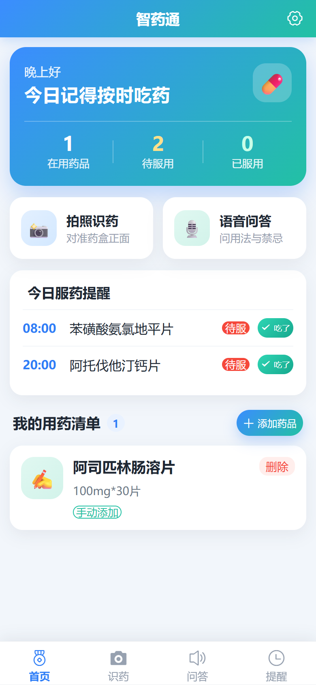
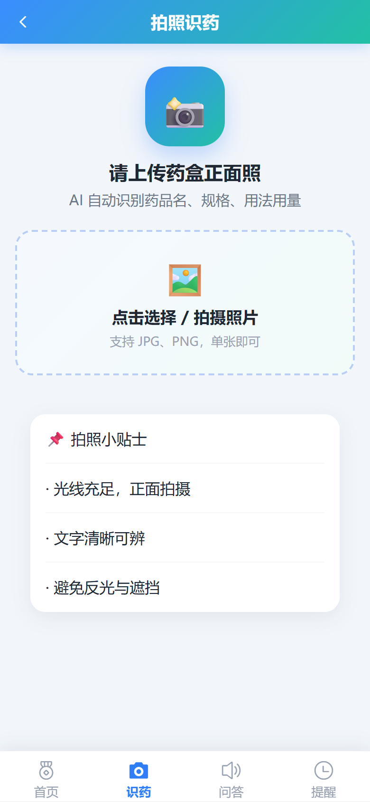
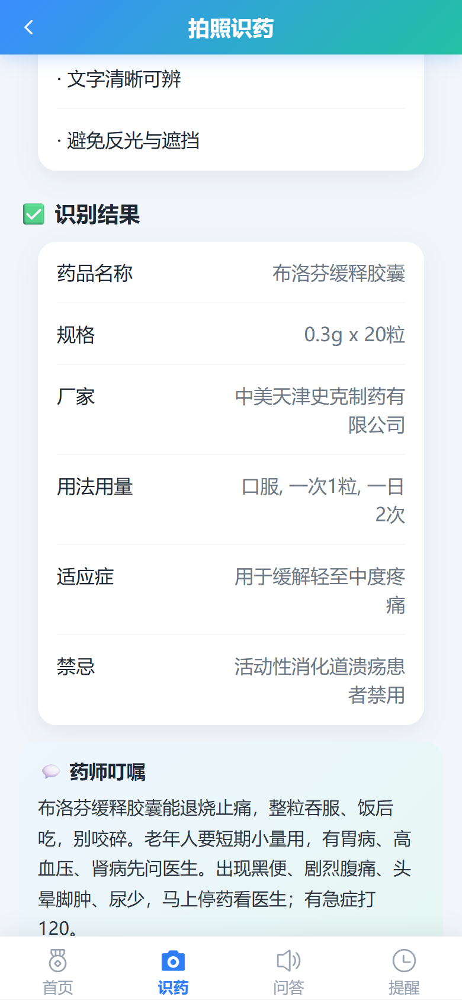
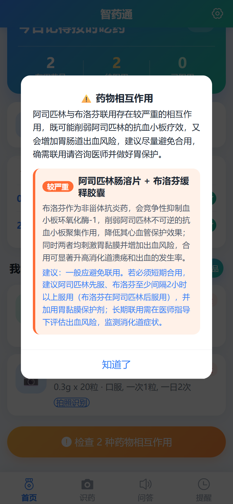
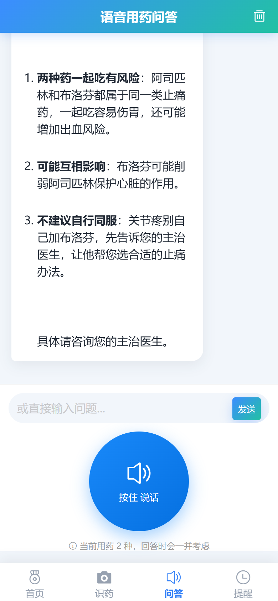
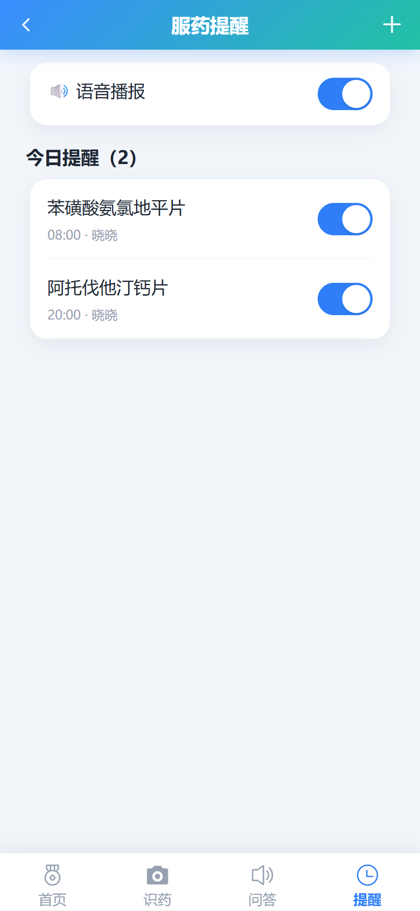

# 智药通 —— AI 老年人用药安全助手 作品介绍文档

> 参赛项目：传智杯 AI 创新应用挑战赛 · 个人赛
> 代码仓库：https://github.com/wuhu2331936/zyt （Public，53 次细粒度提交，v0.4.0 版本发布）
> 在线体验：https://zhiyaotong-330314-11-1509077553.sh.run.tcloudbase.com （已部署公网，浏览器打开即可试用）

## 一、项目详情及使用方式

### 1.1 项目定位

智药通是一款面向老年人及照护者的**AI 用药安全助手**，以手机浏览器即可打开的 H5/PWA（渐进式 Web 应用）形式交付，无需下载安装 App。它解决三个老年人用药的高频痛点：

- **看不懂药盒**：字体小、说明书专业术语密集、药品名称相近难以分辨；
- **记不住风险**：同时服用多种药物时，相互作用和禁忌凭经验判断容易出错；
- **问诊不方便**：子女不在身边时，用药疑问无人可问。

### 1.2 核心功能

| 功能 | 说明 | 背后技术 |
|---|---|---|
| 拍照识药 | 对药盒拍照，先由视觉模型读出盒面信息，再由大模型补全说明书级讲解（用法用量、禁忌、药师叮嘱） | 通义千问 VL（Qwen3-VL）+ DeepSeek 两阶段识别 |
| 用药安全分析 | 输入正在服用的多种药品，分析相互作用与风险等级（如「较严重」） | DeepSeek + ChromaDB RAG 检索增强 |
| 用药提醒 | 按医嘱设置提醒，到点弹窗 + 系统通知 + 语音播报，支持「吃了 / 撤销」 | 前端全局监听 + Notification + Web Speech |
| 语音问答 | 说话提问、语音回答，全程不用打字 | 浏览器 Web Speech + Edge-TTS |

### 1.3 使用方式

1. **在线访问**：浏览器打开上方「在线体验」地址即可使用（已部署到腾讯云 CloudBase 云托管，7×24 小时可访问），支持"添加到主屏幕"作为 PWA 安装；
2. **本地部署**：仓库含 Dockerfile 与一键启动脚本，`pip install -r requirements.txt` 后 `uvicorn` 启动后端、`npm run dev` 启动前端；
3. **云端部署**：仓库含 Dockerfile 与 CloudBase 云托管配置，Git 推送后自动构建部署。

使用流程（以"多药同服风险分析"为例）：首页"我的用药清单"逐个添加正在服用的药品（支持拍照识药自动录入）→ 点击"检查药物相互作用" → 系统先从 30 条内置药品说明书向量库中检索相关段落，再由大模型给出风险等级、冲突说明与建议，全程语音可读。

## 二、项目亮点

1. **真实的适老化设计**：大字体、高对比度、语音优先的交互方式，界面文案经口语化改写（如"相互作用"改述为"一起吃会不会打架"），而非把通用界面简单放大。
2. **检索增强（RAG）约束幻觉**：不裸调大模型，先用 ChromaDB 从结构化药品说明书中检索相关段落，作为事实依据注入 Prompt，显著降低医学幻觉风险；检索不到时明确告知"建议咨询医师/药师"，而非编造答案。
3. **JSON Schema 结构化输出契约**：要求模型按固定 JSON Schema 返回（药品名、风险等级、建议列表），前端按契约渲染，保证输出稳定可解析。
4. **四级失败降级链**：RAG 检索失败 → 退化为纯模型知识；模型超时 → 重试一次；仍然失败 → 给出静态安全提示。任何单一外部依赖故障都不会导致白屏。
5. **轻量 PWA**：可安装、可离线打开壳页面，Vite 构建产物小，适配老年人低配手机与弱网环境。
6. **规范的软件工程**：Conventional Commits、53 次细粒度提交、GitHub Actions CI（前端构建 + 后端 pytest 8 项测试）、MIT License、完整的需求/技术/部署/FAQ 文档。

## 三、AI 技术落地使用情况概述

### 3.1 产品内 AI 能力

- **通义千问 VL（DashScope API，qwen3-vl-plus）**：拍照识药第一阶段，读出药盒正面的药品名、规格、厂家、用法用量；对模糊照片返回"无法识别"而非猜测。
- **DeepSeek（OpenAI 兼容 API）**：识药第二阶段——基于第一阶段结果补全说明书级讲解（老年人注意事项、漏服处理、药师叮嘱）；同时承担用药问答、相互作用分析、风险总结。统一走服务端转发，Key 不落前端。
- **RAG 检索增强**：内置 30 条常见药品结构化说明书，bge-small-zh 中文向量模型 + ChromaDB 持久化检索，Top-4 段落注入 Prompt。
- **Edge-TTS**：中文语音合成回答，免费无 Key，适合老年用户"听"回答。

### 3.2 AI 辅助研发（AI 协同开发）

本项目由 AI 结对开发完成，过程留痕于仓库 `docs/ai-prompts/AI-COLLABORATION-LOG.md`，含 3 条完整可复现的 Prompt 链：

1. **架构设计链**：由需求推导出前后端分离 + RAG 的技术选型与目录结构；
2. **代码实现链**：分阶段生成后端服务/前端页面，并迭代修复跨平台兼容问题；
3. **测试与文档链**：AI 生成 pytest 测试用例、PWA 图标生成脚本与全套中文文档。

CI 中的 8 项 pytest 用例即由 AI 编写并在 AI 协作下定位修复了真实缺陷（如 RAG 可选依赖的导入守卫）。

## 四、项目中涉及的关键技术

- **后端**：Python FastAPI + Pydantic v2（请求/响应模型校验）、uvicorn、python-dotenv 环境配置；
- **前端**：Vue 3 组合式 API + Vite + Vant 组件库 + Pinia 状态管理 + Vue Router 懒加载，vite-plugin-pwa 实现 PWA；
- **AI 集成**：DashScope SDK（Qwen-VL）、DeepSeek HTTP API、Edge-TTS；
- **RAG**：ChromaDB 持久化向量库、BAAI/bge-small-zh 中文 Embedding、Top-K 检索 + Prompt 注入；
- **可靠性**：JSON Schema 输出约束、超时重试、四级降级链、可选依赖优雅降级（未安装 RAG 依赖时应用仍可启动）；
- **工程化**：GitHub Actions CI、Docker、pytest + httpx 异步测试、Conventional Commits。

## 五、项目相关图片

以下截图均来自**线上部署环境的真机运行效果**，与演示视频画面一致：

<figure>
  
  <figcaption>首页 —— 用药概览、今日服药提醒与用药清单</figcaption>
</figure>

<figure>
  
  <figcaption>拍照识药 —— 上传药盒照片，AI 自动识别</figcaption>
</figure>

<figure>
  
  <figcaption>拍照识药 —— 识别结果：结构化药品信息 + 通俗版「药师叮嘱」</figcaption>
</figure>

<figure>
  
  <figcaption>用药安全分析 —— 相互作用风险等级（「较严重」）与具体用药建议</figcaption>
</figure>

<figure>
  
  <figcaption>语音用药问答 —— 口语化提问，结构化回答，支持语音播报</figcaption>
</figure>

<figure>
  
  <figcaption>用药提醒 —— 到点语音播报，支持一键「吃了 / 撤销」</figcaption>
</figure>

## 六、项目之前是否发表或获奖

本项目为本次比赛**首次公开发布**，此前未在任何平台发表，未参加过其他比赛，未获得任何奖项。

## 七、是否基于其他项目优化

否。本项目为**从零开始的原创开发**，未基于任何已有项目二次开发或优化。所有代码、文档、界面设计均在本仓库 Git 历史中可追溯（6 个开发阶段、53 次提交）。
